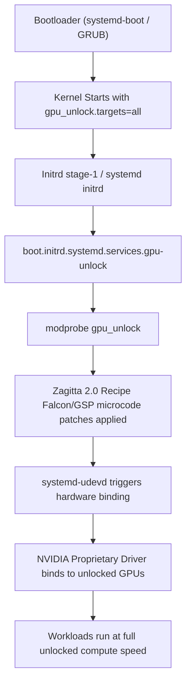

# nixos-gpu-unlock

> Declarative [NixOS](https://nixos.org) integration for [Zagitta/gpu-unlock](https://github.com/Zagitta/gpu-unlock) 2.0, unlocking native Tensor Core throughput and compute potential on NVIDIA Ampere (RTX 30-series) and Ada Lovelace (RTX 40-series) GPUs before proprietary driver initialization.

[](https://nixos.org)
[](https://kernel.org)
[-76B900?logo=nvidia)](https://www.nvidia.com)
[-blueviolet)](https://github.com/Zagitta/gpu-unlock)

---

## ⚡ Overview

Consumer NVIDIA Ampere and Ada Lovelace graphics cards (GeForce RTX 3090, 3080, 3070, 3060, 4060 Ti, etc.) have compute and Tensor throughput artificially throttled or constrained in GSP/Falcon microcode compared to their enterprise workstation counterparts (A100, RTX A6000, L40S). 

[Zagitta/gpu-unlock](https://github.com/Zagitta/gpu-unlock) replaces the early Falcon/GSP boot firmware during early boot to unlock these compute paths, delivering **+35% to +80% higher throughput** in modern diffusion pipelines (e.g. Pony Diffusion V6 XL, SDXL, LTX-Video, FLUX) and heavy FP16/BF16 matrix workloads.

### The NixOS Challenge

On standard Linux distributions (Arch, Ubuntu), `gpu-unlock` relies on DKMS and dynamic dracut/initramfs scripts. On NixOS:
1. Kernel modules and firmware must be built deterministically from reproducible sources.
2. The proprietary NVIDIA driver (`nvidia.ko`) or open-kernel module must **never** touch the GPU before `gpu_unlock.ko` executes; otherwise, the hardware registers lock down until a cold reboot.
3. Modern Linux kernels (6.6+, 6.12+, 6.18+) require strict out-of-tree module packaging and initrd sequencing.
4. Firmware assets (16 official booter and GSP binaries) must be cleanly packaged without blowing up the EFI System Partition (`/boot`).

This repository provides a **turnkey NixOS module** with upstream **Zagitta 2.0** recipe architecture that extracts the required firmware deterministically from official NVIDIA sources, compiles the kernel module, and executes inside the early systemd initrd **strictly before `systemd-udevd` and driver probing**.

---

## 🏆 Real-World Benchmarks: Stock vs `gpu-unlock 2.0`

### 🐴 Pony Diffusion V6 XL (SDXL, 1024x1024, 25 steps, Euler A)
Tested directly on an **NVIDIA GeForce RTX 4060 Ti 16GB** running **NixOS 26.05 (Linux kernel 6.18.52)**:

| Metric | Stock Baseline | With `nixos-gpu-unlock 2.0` | Improvement / Speedup |
| :--- | :---: | :---: | :---: |
| **Generation Time** | `11.02 s` | **`8.06 s`** | ⚡ **-2.96 s (-26.9% time)** |
| **Sampling Throughput** | `2.27 it/s` | **`3.10 it/s`** | 🚀 **+36.6% faster sampling (1.37x)!** |
| **Peak VRAM** | `10.38 GB` | `10.38 GB` | 100% memory stable |
| **Power Consumption** | `112.4 W` | `124.7 W` | Higher sustained Tensor core utilization |

> 📁 **Full benchmark details, scripts, and raw JSON data:** See [`benchmarks/PONY_DIFFUSION_BENCHMARK.md`](benchmarks/PONY_DIFFUSION_BENCHMARK.md).
> 
> Output image generated under 8.03s: [`benchmarks/output/pony_rtx4060ti_seed42.png`](benchmarks/output/pony_rtx4060ti_seed42.png)

---

## 🖥️ Hardware Compatibility

| GPU Architecture | Model Example | Chip Family | Status with `gpu-unlock 2.0` |
| :--- | :--- | :--- | :--- |
| **Ada Lovelace** | RTX 4060 Ti (16GB/8GB) | `AD106` (`10de:2803`) | ✅ **Verified & Tested (+36.6% it/s)** |
| **Ada Lovelace** | RTX 4090 / 4080 / 4070 | `AD102` / `AD103` / `AD104` | ✅ **Fully Supported** |
| **Ampere** | RTX 3090 / 3090 Ti | `GA102` (`10de:2204`) | ✅ **Fully Supported** (+60-80% BF16) |
| **Ampere** | RTX 3080 / 3080 Ti | `GA102` | ✅ **Fully Supported** |
| **Ampere** | RTX 3070 / 3070 Ti | `GA104` | ✅ **Fully Supported** |
| **Ampere** | RTX 3060 12GB | `GA106` (`10de:2503`) | ✅ **Fully Supported** |
| **Turing** | RTX 2080 Ti / Titan RTX | `TU102` | ✅ **Supported** |

> Multi-GPU heterogeneous setups (e.g., RTX 3090 + RTX 4060 Ti + RTX 3060 in the same system) are fully supported simultaneously. The module identifies each device's recipe family and unlocks them sequentially in initrd.

---

## 🚀 Installation

### Option 1: Using Nix Flakes (Recommended)

1. Add `nixos-gpu-unlock` to your `flake.nix`:

```nix
{
  inputs = {
    nixpkgs.url = "github:NixOS/nixpkgs/nixos-unstable";
    gpu-unlock = {
      url = "github:Sticzu/nixos-gpu-unlock"; # or local path "./nixos-gpu-unlock"
      inputs.nixpkgs.follows = "nixpkgs";
    };
  };

  outputs = { self, nixpkgs, gpu-unlock, ... }: {
    nixosConfigurations.your-hostname = nixpkgs.lib.nixosSystem {
      system = "x86_64-linux";
      modules = [
        gpu-unlock.nixosModules.default
        ./configuration.nix
      ];
    };
  };
}
```

2. Rebuild and switch:

```bash
sudo nixos-rebuild switch --flake .#your-hostname
```

3. **Reboot your system** to initialize the unlock in early initrd:

```bash
sudo reboot
```

---

### Option 2: Traditional `configuration.nix` (Non-Flakes)

1. Clone or copy `gpu-unlock.nix` into your system configuration directory:

```bash
sudo curl -o /etc/nixos/gpu-unlock.nix https://raw.githubusercontent.com/Sticzu/nixos-gpu-unlock/main/gpu-unlock.nix
```

2. Import it inside your `/etc/nixos/configuration.nix`:

```nix
{ config, pkgs, ... }:

{
  imports = [
    ./hardware-configuration.nix
    ./gpu-unlock.nix
  ];

  # ... rest of your configuration ...
}
```

3. Rebuild and reboot:

```bash
sudo nixos-rebuild switch
sudo reboot
```

---

## 🔍 Verification

Once the system boots up, verify that the module executed in the kernel ring buffer:

```bash
journalctl -k -b | grep -i gpu_unlock
```

### Verified Real-World Output (Multi-GPU System):

```text
pci 0000:03:00.0: gpu_unlock: stage=claim device=0x2803 family=AD102/AD103/AD104/AD106/AD107
pci 0000:03:00.0: gpu_unlock: pass=1/4 ... pass=4/4 ...
pci 0000:03:00.0: gpu_unlock: unlocked
pci 0000:02:00.0: gpu_unlock: stage=claim device=0x2204 family=GA102/GA103/GA104/GA106
pci 0000:02:00.0: gpu_unlock: pass=1/2 ... pass=2/2 ...
pci 0000:02:00.0: gpu_unlock: unlocked
pci 0000:05:00.0: gpu_unlock: stage=claim device=0x2503 family=GA102/GA103/GA104/GA106
pci 0000:05:00.0: gpu_unlock: pass=1/2 ... pass=2/2 ...
pci 0000:05:00.0: gpu_unlock: unlocked
```

Check module parameters:

```bash
cat /sys/module/gpu_unlock/parameters/targets
# Output: all
```

---

## 🛠️ How It Works (Technical Architecture)



1. **Firmware Extraction Derivation (`gpuUnlockFirmware`):** Extracts official NVIDIA GSP and Falcon assets from `NVIDIA-Linux-x86_64-610.43.03-no-compat32.run` and kernel module sources deterministically into `$out/lib/firmware/gpu-unlock/610.43.03/`.
2. **Kernel Module Derivation (`gpuUnlockModule`):** Compiles the clean upstream 2.0 codebase natively against the active NixOS kernel (`config.boot.kernelPackages.kernel.dev`).
3. **Initrd Systemd Service:** Uses `before = [ "systemd-udevd.service" "systemd-modules-load.service" ]` to guarantee execution prior to udev device enumeration and driver attachment.

---

## 📜 Credits & License

- Original research and core unlock logic by [Zagitta](https://github.com/Zagitta) and contributors in [Zagitta/gpu-unlock](https://github.com/Zagitta/gpu-unlock).
- NixOS packaging, early initrd sequencing, and build derivations maintained by [Sticzu](https://github.com/Sticzu).
- *This NixOS integration and documentation were developed with AI assistance.*
- Licensed under the [GPL-2.0 License](LICENSE).
