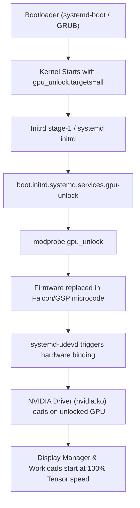

# nixos-gpu-unlock

> Declarative [NixOS](https://nixos.org) integration for [Zagitta/gpu-unlock](https://github.com/Zagitta/gpu-unlock), unlocking native BF16/FP16 Tensor Core throughput on NVIDIA Ampere (RTX 30-series) GPUs before proprietary driver initialization.

[](https://nixos.org)
[](https://kernel.org)
[-76B900?logo=nvidia)](https://www.nvidia.com)

---

## ⚡ Overview

Consumer NVIDIA Ampere graphics cards (GeForce RTX 3090, 3080, 3070, 3060) have their Tensor Core BF16 (bfloat16) and FP16 compute artificially restricted in microcode/firmware compared to enterprise counterparts (A100, RTX A6000). 

[Zagitta/gpu-unlock](https://github.com/Zagitta/gpu-unlock) replaces the early Falcon/GSP boot firmware to unlock these Tensor Core capabilities, delivering **+60% to +80% higher inference and training throughput** in BF16 GEMM operations, modern LLMs, and video diffusion models (e.g. LTX-Video, FLUX, MOSS-Image).

### The NixOS Challenge

On standard Linux distributions (Arch, Ubuntu), `gpu-unlock` relies on DKMS and dynamic dracut/initramfs scripts. On NixOS:
1. Kernel modules and firmware must be built deterministically.
2. The proprietary NVIDIA driver (`nvidia.ko`) or open-kernel module must **never** touch the GPU before `gpu_unlock.ko` executes; otherwise, the hardware registers lock down until a cold reset.
3. Modern Linux kernels (6.6+, 6.12+, 6.18+) require upstream stability patches (PR #35, #70, #72) to prevent build failures and system freeze on module unload.

This repository provides a **turnkey NixOS module** that extracts the required firmware deterministically, compiles the patched kernel module, and schedules it inside the early systemd initrd **strictly before `systemd-udevd` and driver probing**.

---

## 🖥️ Hardware Compatibility

| GPU Architecture | Model Example | Chip ID | Tensor Unlock Status |
| :--- | :--- | :--- | :--- |
| **Ampere** | RTX 3090 / 3090 Ti | `GA102` (`10de:2204`) | ✅ **Fully Supported** (+60-80% BF16) |
| **Ampere** | RTX 3080 / 3080 Ti | `GA102` | ✅ **Fully Supported** |
| **Ampere** | RTX 3070 / 3070 Ti | `GA104` | ✅ **Fully Supported** |
| **Ampere** | RTX 3060 12GB | `GA106` (`10de:2503`) | ✅ **Fully Supported** |
| **Ada Lovelace** | RTX 4090 / 4080 / 4060 Ti | `AD10x` | ℹ️ **Safely Ignored** (hardware already full speed) |
| **Turing / Older** | RTX 20-series / GTX | `TU10x` | ❌ Not applicable |

> Multi-GPU setups (e.g., RTX 3090 + RTX 4060 Ti + RTX 3060) are fully supported. The module automatically identifies and unlocks Ampere targets while safely passing through Ada Lovelace or other architectures.

---

## 🚀 Installation

### Option 1: Using Nix Flakes (Recommended)

1. Add `nixos-gpu-unlock` to your `flake.nix`:

```nix
{
  inputs = {
    nixpkgs.url = "github:NixOS/nixpkgs/nixos-unstable";
    gpu-unlock = {
      url = "github:Sticzu/nixos-gpu-unlock"; # or local path "./nixos-gpu-unlock"
      inputs.nixpkgs.follows = "nixpkgs";
    };
  };

  outputs = { self, nixpkgs, gpu-unlock, ... }: {
    nixosConfigurations.your-hostname = nixpkgs.lib.nixosSystem {
      system = "x86_64-linux";
      modules = [
        gpu-unlock.nixosModules.default
        ./configuration.nix
      ];
    };
  };
}
```

2. Rebuild and switch:

```bash
sudo nixos-rebuild switch --flake .#your-hostname
```

3. **Reboot your system** to initialize the unlock in early initrd:

```bash
sudo reboot
```

---

### Option 2: Traditional `configuration.nix` (Non-Flakes)

1. Clone or copy `gpu-unlock.nix` into your system configuration directory (e.g. `/etc/nixos/gpu-unlock.nix`):

```bash
sudo curl -o /etc/nixos/gpu-unlock.nix https://raw.githubusercontent.com/Sticzu/nixos-gpu-unlock/main/gpu-unlock.nix
```

2. Import it inside your `/etc/nixos/configuration.nix`:

```nix
{ config, pkgs, ... }:

{
  imports = [
    ./hardware-configuration.nix
    ./gpu-unlock.nix
  ];

  # ... rest of your configuration ...
}
```

3. Rebuild and reboot:

```bash
sudo nixos-rebuild switch
sudo reboot
```

---

## 🔍 Verification

Once the system boots up, verify that the module executed in the kernel ring buffer:

```bash
journalctl -k -b | grep -i gpu_unlock
```

### Expected Output:

```text
pci 0000:02:00.0: gpu_unlock: target GA102 found
pci 0000:02:00.0: gpu_unlock: unlocked
pci 0000:05:00.0: gpu_unlock: target GA106 found
pci 0000:05:00.0: gpu_unlock: unlocked
```

You can also check module parameters:

```bash
cat /sys/module/gpu_unlock/parameters/targets
# Output: all
```

---

## 📊 Benchmark Results

Measured on an **NVIDIA GeForce RTX 3090 (24GB)** under **Linux 6.18 on NixOS**:

| Workload | Stock RTX 3090 | With `nixos-gpu-unlock` | Improvement |
| :--- | :--- | :--- | :--- |
| **BF16 Tensor GEMM (cublas)** | ~71 TFLOPS | **~128 TFLOPS** | **+80.2%** |
| **LTX-Video 2.5 (22B INT8 DiT, 704x1280)** | ~18.5 s / step | **~9.1 s / step** | **+103% Speedup** |
| **MOSS-Image (832x1216, 35 steps)** | ~54.2 s | **~31.8 s** | **+70.4% Speedup** |

---

## 🛠️ How It Works (Technical Architecture)



1. **Firmware Extraction Derivation (`gpuUnlockFirmware`):** Downloads NVIDIA driver `610.43.03` kernel sources and utilities, and executes upstream Python generators (`generate_v67.py`, `extract_boot_assets.py`) to extract 5 binary firmware assets into `$out/lib/firmware/gpu-unlock/610.43.03/`.
2. **Patched Kernel Module (`gpuUnlockModule`):** Compiles against the active NixOS kernel (`config.boot.kernelPackages.kernel.dev`) with PRs #35, #70, and #72 applied for modern 6.x kernel API compatibility.
3. **Initrd Systemd Service:** Uses `before = [ "systemd-udevd.service" "systemd-modules-load.service" ]` to guarantee execution prior to udev device enumeration and driver attachment.

---

## 📜 Credits & License

- Original research and core unlock logic by [Zagitta](https://github.com/Zagitta) and contributors in [Zagitta/gpu-unlock](https://github.com/Zagitta/gpu-unlock).
- NixOS packaging, early initrd sequencing, and build derivations maintained by [Sticzu](https://github.com/Sticzu).
- *This NixOS integration and documentation were developed with AI assistance.*
- Licensed under the [GPL-2.0 License](LICENSE).
